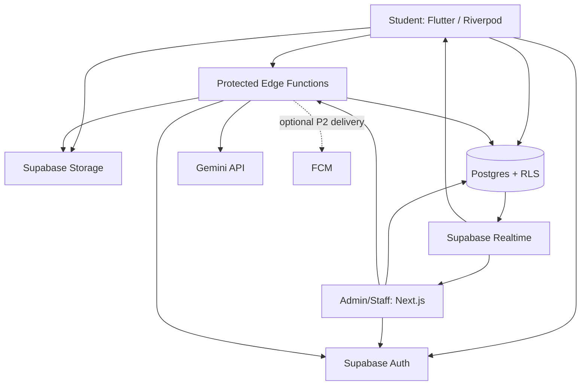
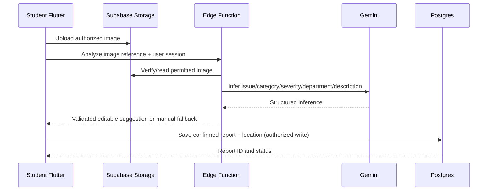
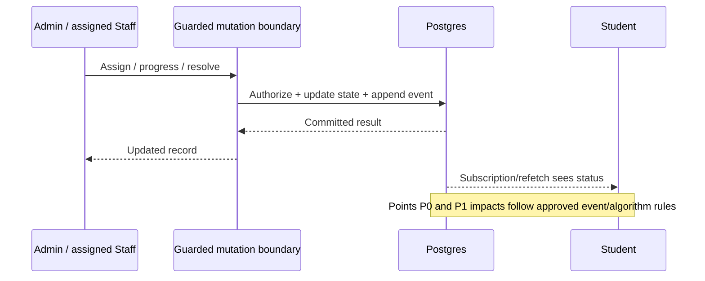

# End-to-End EcoCampus System Architecture

> **Path:** `docs/03-engineering/system-architecture.md`  
> **Status:** DRAFT — comprehensive agent-ready specification for review, **not approved implementation authority**.  
> **PRD:** EcoCampus PRD v1.0 §§6, 18–20, 24; legacy registry: DOC-016; DOC-017; DOC-018.  
> **Decision gates:** `DEC-006`, `DEC-007`, `DEC-010`, `DEC-011`.

## Contract status and authority

- **Source-backed:** Statements explicitly labeled *PRD baseline* reproduce EcoCampus PRD v1.0. Paragraphs labeled *proposed design* are implementation candidates, not approved requirements.
- **Approval gate:** `DEC-001` through `DEC-013` in the existing decision register are `PROPOSED`. No suggestion in this document approves them. For blocked implementation work, obtain written human sign-off; log changed requirements before coding.
- **Scope:** P0 is must-have, P1 high-value, P2 stretch. Optional home widgets do not automatically promote P1 or P2 backend features into P0.
- **Source references:** `EcoCampus_PRD.docx` §numbers; existing `docs/00-control/requirements-traceability.md` for stable `REQ-*` and `TEST-*` IDs; `docs/00-control/decision-register.md` for dependencies.
- **Implementation honesty:** Examples, scores, expected savings and seed data are illustrative until measured or approved. Do not describe unimplemented designs or unexecuted tests as production-ready.

## PRD technology baseline
- Mobile: **Flutter / Dart / Riverpod**.
- Admin: **Next.js / TypeScript / Tailwind CSS**, charts via **Recharts**.
- Backend: **Supabase** Auth, PostgreSQL, Storage, Realtime, Edge Functions.
- AI: **Gemini API** called from Edge Functions (never mobile app).
- Notifications: **Firebase Cloud Messaging** identified by PRD stack; precise P0 delivery and setup pending `DEC-011`.
- Map: custom **2D SVG** for MVP, not 3D.

## Logical component diagram

*Arrows are logical proposed interactions consistent with the PRD, not proof of an implemented topology or enabled direct DB access paths.*

## Trust boundaries
1. Flutter and browser are untrusted clients: no service-role, Gemini, SMTP or FCM server credentials shipped.
2. JWT/identity must be verified at each privileged request; UI role checks are not security boundaries.
3. PostgreSQL RLS is mandatory for tables exposed to authenticated clients (PRD §20).
4. Storage object access must be scoped to authorized reporter/Admin/assigned Staff roles; private image download should use guarded short-lived access.
5. Cross-user aggregates must be computed from allowed data via verified server logic where RLS alone cannot provide the correct representation.

## Sequence A — report creation (P0)

## Sequence B — resolution and derived events

## Data domains and authorities (proposed)
| Domain | Primary authority | Write roles | Derived consumers |
|---|---|---|---|
| Identities/profiles | Supabase Auth / protected profile table | Owner/admin based on policy | Apps, permissions |
| Campus locations | Canonical relational records | Admin-controlled seeding | Picker, map, analytics |
| Reports and photos | Reporter-owned row + private storage | Reporter create; privileged workflow mutations | Tracking, AI, dashboard |
| Status and assignment history | Append-only audit/events | Server-guarded Admin/assigned Staff | Notifications, points, analytics |
| Rewards ledger | Server mutation from eligible event | Trusted logic only | Home, leaderboard |
| Insights/scores/impact | Reproducible view or calc output | Trusted backend jobs/functions | Charts and advisor |

## Recommended module boundaries — proposal
- Flutter packages grouped by `auth`, `reporting`, `campus`, `reports`, `rewards`, `profile` rather than one global store.
- Admin Next.js modules `issues`, `staff`, `analytics`, `map`, and optional `advisor`.
- Edge Functions `analyze-report`, `create-report` (if not direct protected insertion), `transition-report`, `calculate-insights`; precise endpoint names await API contract approval.
- SQL migrations own schemas/policies; Edge Functions own server-side external service interactions.

## Reliability, fallback, and consistency
- Gemini error must not block manual report submission (PRD §24).
- Prevent repeated submit causing double reports (idempotency candidate requires review).
- Use realtime as UI acceleration; canonical record fetch is source of truth after reconnect.
- Report lifecycle/history and reward events should be transactionally consistent, not independently best-effort client writes.
- Store enough timestamps/source identifiers to reconstruct analytics; no stale simulation data represented as live.

## Architecture decision records / exclusions
- `DEC-011`: hosting, native release channel, push fallback, rate limits, secret/env scope.
- `DEC-006`: cross-user visibility, protected media and aggregate data access.
- `DEC-010`: staff tenancy/interface and assignment scope.
- Exclude IoT, digital twin, live metering and ERP integration in hackathon build (PRD §4).

## Agent acceptance checklist (proposed)

- [ ] Student report can move from image to stored report while keeping Gemini key server-side.
- [ ] Admin and Staff are subject to server authorization, not only UI guards.
- [ ] No public storage object URL permits arbitrary cross-user image access.
- [ ] Realtime disconnect still allows re-fetching authoritative report state.
- [ ] Out-of-scope IoT/3D/metering components are not added to the deployed MVP.

## Agent execution protocol

1. Read this document together with the original PRD, approved decision register and relevant sibling specifications before modifying code.
2. Identify exact feature tier, acceptance scenarios, data ownership and denied-role tests. Distinguish requirements from proposed design choices.
3. Do not implement a blocked formula, privacy policy, status transition or reward event until the listed decision gate is approved.
4. Keep changes in a narrowly scoped branch/PR with migrations, typed contracts, automated tests, screenshots/log evidence and rollback considerations when relevant.
5. Verify behavior on an actual clean staging configuration. Record `PASS`, `FAIL`, `BLOCKED` or `NOT_RUN` against source-linked test IDs; never claim passing tests without running them.
6. Update the requirement traceability and decision record when contracts change; never silently renumber existing IDs.

## Source-backed requirement linkage

The rows below are extracted from the previously authored 217-row EcoCampus requirements traceability matrix. This is a **cross-reference**, not evidence of execution or approval.

| Requirement ID | Source statement (paraphrase) | PRD citation | Scope | Decision gate |
|---|---|---|---|---|
| `REQ-TECH-001` | Student application targets Android and iOS | §§18–19 | BASE | DEC-011 |
| `REQ-TECH-002` | Mobile implementation uses Flutter and Dart | §§18–19 | BASE | — |
| `REQ-TECH-003` | Mobile state management uses Riverpod | §§18–19 | BASE | — |
| `REQ-TECH-004` | Admin web app uses Next.js and TypeScript | §§18–19 | BASE | — |
| `REQ-TECH-005` | Admin UI uses Tailwind CSS | §§18–19 | BASE | — |
| `REQ-TECH-006` | Admin charts use Recharts | §§18–19 | BASE | — |
| `REQ-TECH-007` | Backend platform uses Supabase | §§18–19 | BASE | — |
| `REQ-TECH-008` | Relational database uses PostgreSQL | §§18–19 | BASE | — |
| `REQ-TECH-009` | Auth is implemented using Supabase Auth | §§18–19 | BASE | — |
| `REQ-TECH-010` | Photo/media persistence uses Supabase Storage | §§18–19 | BASE | — |
| `REQ-TECH-011` | Realtime capability uses Supabase Realtime | §§18–19 | BASE | — |
| `REQ-TECH-012` | Server-side logic uses Supabase Edge Functions | §§18–19 | BASE | — |
| `REQ-TECH-013` | AI provider is Gemini API | §§18–19 | BASE | — |
| `REQ-TECH-014` | Notifications stack includes Firebase Cloud Messaging | §§18–19 | BASE | DEC-011 |
| `REQ-TECH-015` | MVP map representation uses custom SVG campus map | §§18–19 | BASE | DEC-008 |
| `REQ-TECH-016` | Version control uses Git and GitHub | §§18–19 | BASE | — |

16 source-linked rows displayed of 16 applicable rows. The full master registry in the earlier control docs remains authoritative; this subset is informational.

## Approval record

| Field | Value |
|---|---|
| Product reviewer | TBD |
| Technical reviewer | TBD |
| Security / quality reviewer, where applicable | TBD |
| Blocking decisions approved? | No — consult decision register |
| Implementation status | Not assessed; this is a planning/specification document |
| Approval date / revision | Pending |
